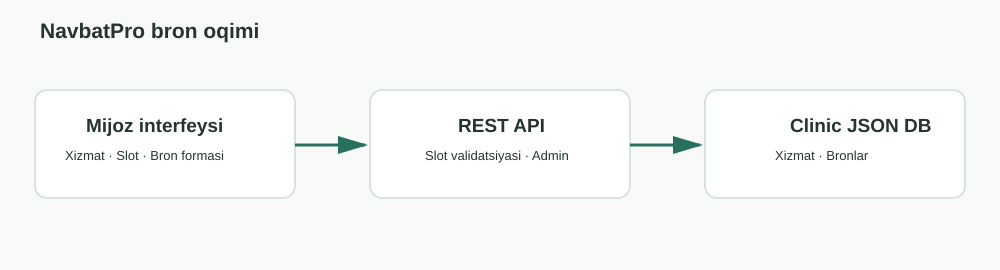

# NavbatPro

**Kutish emas, rejalash.** NavbatPro — kichik klinika va xizmat markazlari uchun onlayn navbat bron qilish web-ilovasi. Mijoz xizmat va mutaxassisni tanlaydi, bo‘sh vaqtni ko‘radi, o‘z ma’lumotlarini yuboradi va bron raqamini oladi.



## Muammo va yechim

Kichik klinikalarda navbat ko‘pincha telefon yoki chat orqali yuritiladi. Natijada bir vaqtga ikki mijoz yozilishi, bo‘sh vaqtni topish qiyinligi va operatorning qo‘lda ko‘p ish qilishi muammosi paydo bo‘ladi. NavbatPro slotni serverda qayta tekshiradi, bronni saqlaydi va admin uchun tartibli ro‘yxat beradi.

## Imkoniyatlar

- xizmatlar, davomiylik, narx va mutaxassislarni ko‘rsatish;
- sana tanlash va bo‘sh vaqt slotlarini olish;
- bir band qilingan vaqtni ikkinchi marta bron qilishga yo‘l qo‘ymaslik;
- mijoz ismi, telefoni va izohi bilan bron yuborish;
- bron raqami va shifokor ma’lumotlarini ko‘rsatish;
- admin kaliti orqali bronlar ro‘yxatini ko‘rish;
- bron statuslarini `new`, `confirmed`, `completed`, `cancelled` qiymatlariga o‘zgartirish API’i;
- responsive mobil va desktop interfeys;
- noto‘g‘ri forma, band slot, bo‘sh holat va server xatoliklari uchun xabarlar.

## Texnologiyalar

| Qism | Texnologiya |
|---|---|
| Frontend | Semantic HTML, CSS, Vanilla JavaScript |
| Backend | Node.js built-in HTTP server |
| API | REST + JSON |
| Saqlash | JSON fayl (`data/clinic.json`) |
| Tekshiruv | `node --check` va smoke testlar |

Loyiha tashqi AI API yoki pullik xizmatga bog‘liq emas. Bron va slot nazorati server tomonida bajariladi.

## Ishga tushirish

```bash
git clone https://github.com/RaximjonRaximov/navbatpro.git
cd navbatpro
cp .env.example .env
npm start
```

Brauzerda `http://localhost:3030` manzilini oching. Node.js 18 yoki undan yangi versiya kerak. Development uchun `npm run dev` ishlatish mumkin.

## API

| Method | Endpoint | Vazifasi |
|---|---|---|
| GET | `/api/health` | Server holatini tekshirish |
| GET | `/api/services` | Xizmatlar va mutaxassislar |
| GET | `/api/slots?date=2026-11-21&service=s1` | Tanlangan kunning bo‘sh slotlari |
| POST | `/api/bookings` | Yangi bron yaratish |
| GET | `/api/bookings` | Admin bronlar ro‘yxati |
| PATCH | `/api/bookings/:id` | Admin bron statusini o‘zgartirish |

Bron yuborish namunasi:

```json
{
  "serviceId": "s1",
  "date": "2026-11-21",
  "time": "09:30",
  "customer": {
    "name": "Madina Karimova",
    "phone": "+998 90 123 45 67"
  },
  "note": "Birinchi tashrif"
}
```

Admin endpointlari `x-admin-key` headerini talab qiladi. Lokal qiymat `.env.example` dagi `demo-admin-key`:

```bash
curl http://localhost:3030/api/bookings \\
  -H 'x-admin-key: demo-admin-key'
```

## Tekshiruv buyruqlari

```bash
npm run lint  # server va frontend JavaScript sintaksisi
npm test      # 5 ta smoke test
npm start     # serverni ishga tushirish
```

Asosiy oqim tekshiruvi xizmatlarni olish, slotlarni olish, bron yaratish, bir slotni qayta bron qilishni bloklash va admin status API’ini o‘z ichiga oladi.

## Papkalar tuzilmasi

```text
server.js                 # REST API, slot va bron logikasi
public/index.html         # bron qilish interfeysi
public/style.css          # responsive klinika dizayni
public/app.js             # slot, forma va admin UI oqimi
data/clinic.json          # xizmatlar va bronlar bazasi
docs/architecture.svg     # README diagrammasi
.env.example              # PORT, DATA_FILE va ADMIN_KEY
plan.md                   # mahsulot va dizayn rejasi
TODO.md                   # qabul mezonlari
test.js                   # smoke testlar
```

## Production cheklovlari va keyingi bosqich

MVP kichik klinika demo yoki lokal foydalanish uchun tayyor. Ishlab chiqarishda PostgreSQL, foydalanuvchi loginlari, xodim rollari, SMS/email eslatmalar, vaqt zonasi qoidalari, audit log, HTTPS, rate limit va backup qo‘shilishi kerak. Hozirgi versiya to‘lov qabul qilmaydi va bemorning tibbiy tarixini saqlamaydi.

## Litsenziya

MIT
